# 00: Install and Setup (before the workshop, or 10 min with us)

**What we're doing:** getting the Claude desktop app onto your laptop, signed in, and opened on the app repo, so every module after this is just exercises.

## Install the Claude app

Download the Claude Code desktop app from: [claude.com/download](https://claude.com/download) and install it like any other app.

## Sign in

To use claude code, you are going to need a paid subscription (Pro, Max, Team, or Enterprise) or an API key. **The free plan doesn't include Claude Code**. If you do not have a subscription, we are offering access to an API key, but you won't be able to do M7 as intended without a personal plan.

**Option A: you have a paid Claude plan.** Open the app and sign in with your Claude account. That's it.

**Option B: you're using the API key from your CSUS**

1. Open the app, create a free Claude account (or sign in to the one you have), and follow the setup steps until you reach the main screen:

   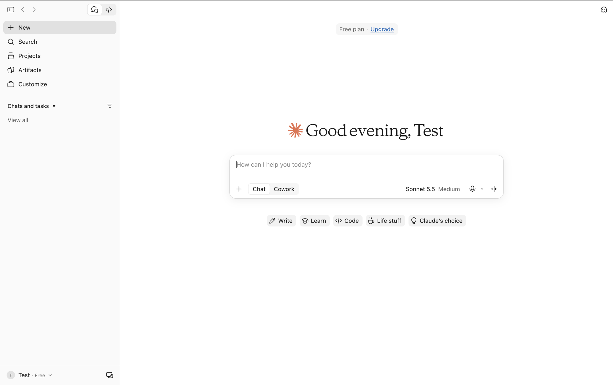

2. Turn on developer mode: **Help → Troubleshooting → Enable Developer Mode**. On a Mac, **Help** is in the menu bar at the top of the screen. On Windows, it's under the **☰** menu in the top-left corner of the app.

   Windows:

   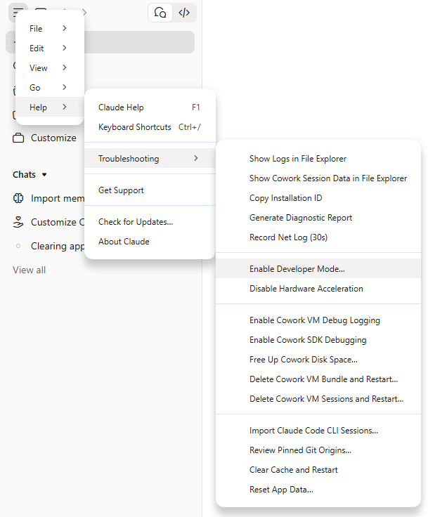

   Mac:

   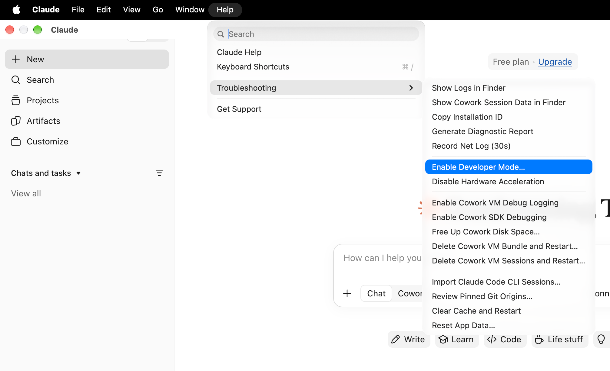

3. The app restarts, and a new **Developer** menu shows up next to Help. Choose **Developer → Configure Third-Party Inference…**

   Windows:

   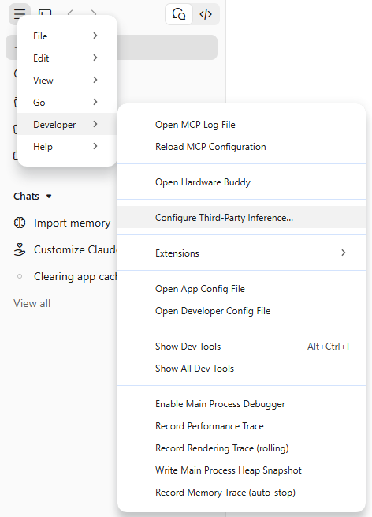

   Mac:

   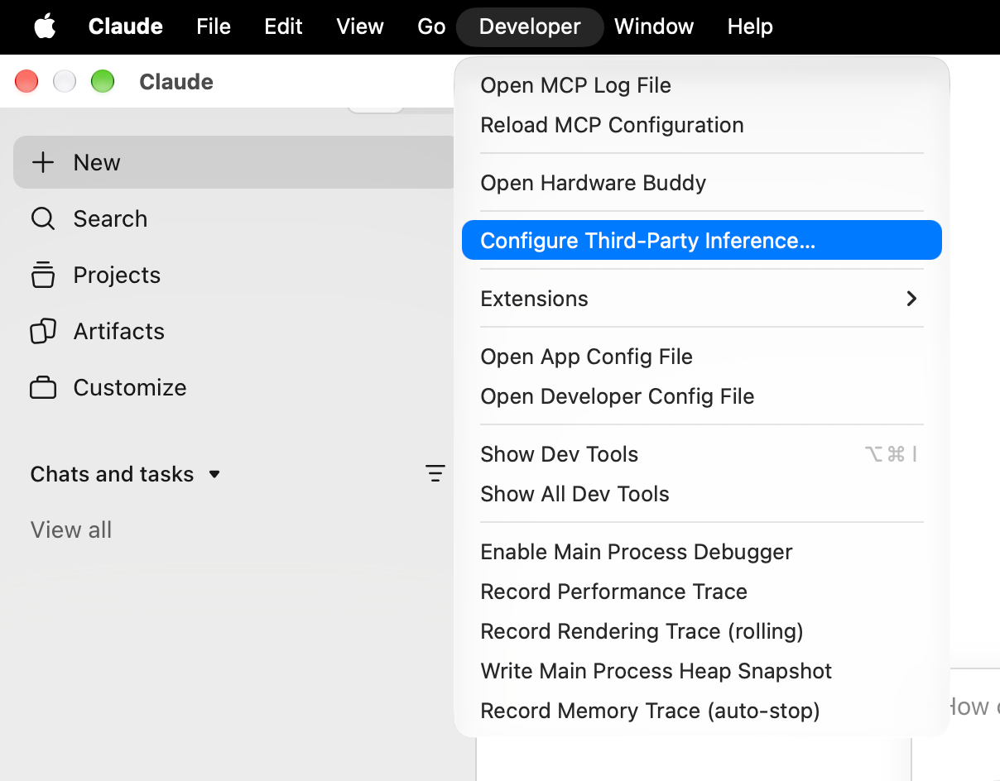

4. A settings window opens on **Connection**. Open the dropdown that says **Gateway** and pick **Claude API**:

   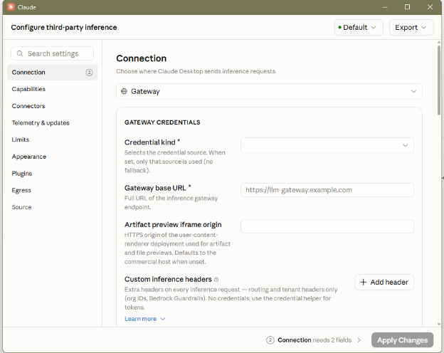

   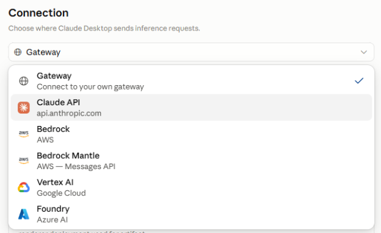

5. Set **Credential kind** to **Static API key**, then paste the key from the [Private Bin](https://privatebin.net/?e2637766b2e2d6bb#3RoofpncYgwXb7TwkBL7qojLkw9wwhXcnyivMp3BLa3A). Ask an organizer for the password!

   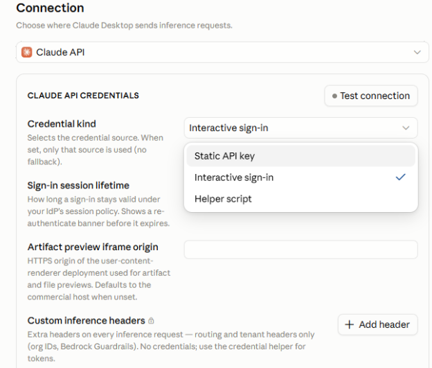

6. Click **Apply Changes**, then **Save & Restart**.
7. When the app comes back, the sign-in screen has a new option to start with the configuration you just entered. Pick that one.

**Never paste your key into Discord, a prompt, or a committed file.** The keys get revoked the night of the workshop anyway.

## Open the repo in the Code tab

1. Click **Code** at the top of the sidebar:

   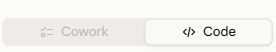

2. Start a **new session** (**+ New** at the top of the sidebar). Under the prompt box, set the environment to **This computer** (the top entry under **Local**). Then click the folder control next to it, choose **Open folder…**, and pick your `csus-event-hub` folder. Then set the model to **Sonnet 5.5**:

   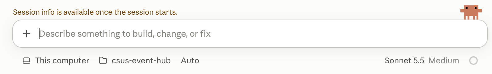

## The app's terminal

You can use the apps built-in terminal by hitting the button in the top-right corner of the session. It starts inside the folder you chose from the step above.

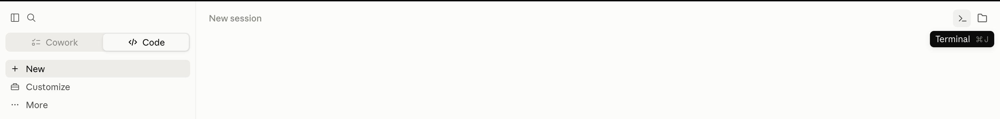

Check the app can see the repo's Python by running the tests from there:

| Mac                          | Windows                          |
| ---------------------------- | -------------------------------- |
| `.venv/bin/python -m pytest` | `.venv/Scripts/python -m pytest` |

**Every test should pass**, the same as when you set the repo up.

## You're good to go when

- the tests pass in the app's terminal
- you have a session open on the `csus-event-hub` folder
