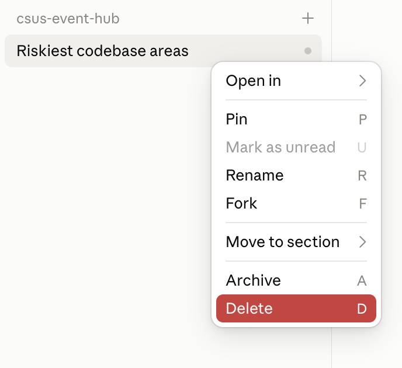

# M2: Project Instructions (15 min)

**What we're doing:** writing instruction files that change what the AI produces, in ways we can actually check.

## The idea

`CLAUDE.md` files get loaded into every session, so the AI stops re-guessing your stack and conventions every time. What I noticed: short, specific, command-style rules work way better than long, aspirational ones.

## Exercise (10 min): same feature, with and without instructions

We send the same prompt twice and compare what comes back:

- **Run A:** no instruction files. Claude only knows what it can work out from the code.
- **Run B:** after we add a `CLAUDE.md` with our team's rules.

These are the rules we're watching. After each run, open the diff view and check which ones it followed:

- [ ] **Logic goes in services:** the code that finds and deletes the RSVP is a new function in a file under `app/services/`. The new route in `app/routes/rsvps.py` just calls that function.
- [ ] **Status constants in the app:** the new code in `app/` writes status codes as `status.HTTP_404_NOT_FOUND`, not bare numbers like `404` or `status_code=204`.
- [ ] **Status constants in tests:** the new tests check `== status.HTTP_404_NOT_FOUND`, not `== 404`. No tests at all doesn't count.

### Run A

1. Start with an empty conversation: in the sidebar, open the menu on your previous conversation and choose **Delete**. Then start a new one with **+ New**, on the `csus-event-hub` folder with **Sonnet 5.5**, like in 00.

   

   > **Why delete instead of `/clear`?** `/clear` empties the chat, but it's still the same running session, and a running session doesn't always notice files you've added since it started (instruction files, skills, agents, hook settings). A brand-new conversation reads all of them fresh and remembers nothing from the last run, so every run starts from the same clean slate, yours and everyone else's. Deleting the old one also keeps the sidebar tidy, so you never continue an old conversation by accident. We do it this way every time we need a fresh start today.

2. Ask for a feature:

   > Add an endpoint to cancel an RSVP.

3. Go through the checklist.
4. Throw the change away. In the app's terminal, run `git reset --hard`, then `git clean -fd`. Then delete this conversation and start a new one, the same way as step 1.

### Run B

5. Create a file called `CLAUDE.md` in the repo root (the same folder as `README.md`) and paste this in. It's what Claude would otherwise have to work out from the code, plus our team's rules at the end:

   ```markdown
   # CLAUDE.md
   <!-- Claude reads this file at the start of every conversation. It strips HTML comments like this one first, so they're notes for you, not instructions. -->

   CSUS Event Hub: a FastAPI + SQLModel API on SQLite for club events, members, and RSVPs.

   ## Commands
   <!-- The exact commands, so Claude doesn't have to guess how to run things (or which Python to use). -->
   The venv is never activated: call its Python by path (on Windows, `.venv/Scripts/python` instead of `.venv/bin/python`).

   - Run tests: `.venv/bin/python -m pytest`
   - Run one test: `.venv/bin/python -m pytest tests/test_events.py -k <name>`
   - Lint and auto-fix: `.venv/bin/python -m ruff check --fix .`
   - Format: `.venv/bin/python -m ruff format .`

   ## Layout
   <!-- Where things live, so Claude goes straight to the right file instead of searching for it. -->
   - `app/main.py`: creates the app and wires up the routers
   - `app/models.py`: the SQLModel tables and schemas (`Event`, `Member`, `RSVP`)
   - `app/routes/`: one router per resource (`events`, `members`, `rsvps`, `stats`)
   - `app/services/`: business logic. Events go through `app/services/events.py`; members and RSVPs still keep their logic in the route handlers
   - `tests/conftest.py`: fixtures that give each test a fresh in-memory database

   ## Team rules
   <!-- What Claude can't learn from the code: how the team wants things done. -->
   - Routes stay thin: put new logic in app/services/, even in routers that don't do this yet
   - Use `fastapi.status` constants (`status.HTTP_404_NOT_FOUND`), never bare status codes
   - Don't edit .env files or add dependencies without asking
   - Don't commit or push any changes made by claude.
   ```

6. Add a **scoped** instruction file at `tests/CLAUDE.md`. Claude pulls it in whenever it's working on files in that folder:

   ```markdown
   # Test conventions
   <!-- Rules for tests only: Claude loads this file when it works on files in tests/. -->
   - Reuse the `client`, `session`, `make_event`, and `make_member` fixtures; never start a real server
   - Assert status codes with `fastapi.status` constants too (`== status.HTTP_404_NOT_FOUND`), never bare numbers
   ```

7. Delete this conversation and start a new one again, so it starts by reading your new files. Send the prompt from step 2 again, and go through the checklist. Which rules did B follow that A didn't?
8. Save your work. In the app's terminal, run `git add -A`, then `git commit -m "add instruction files"`. The next modules use these files, and their `git reset --hard` / `git clean -fd` steps would delete them if they weren't committed.
